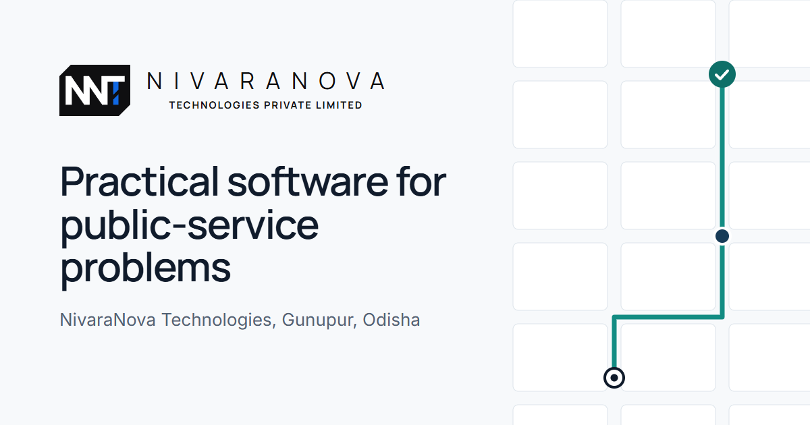
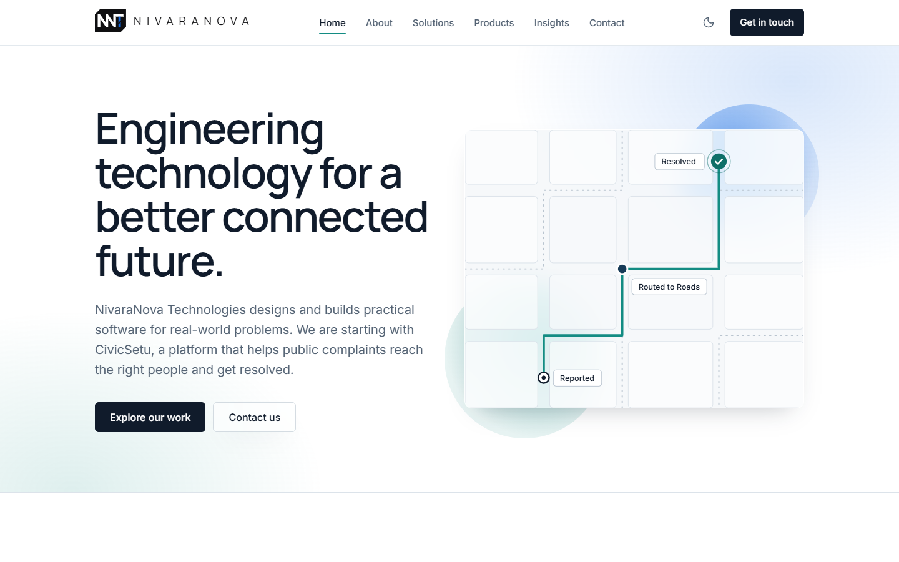
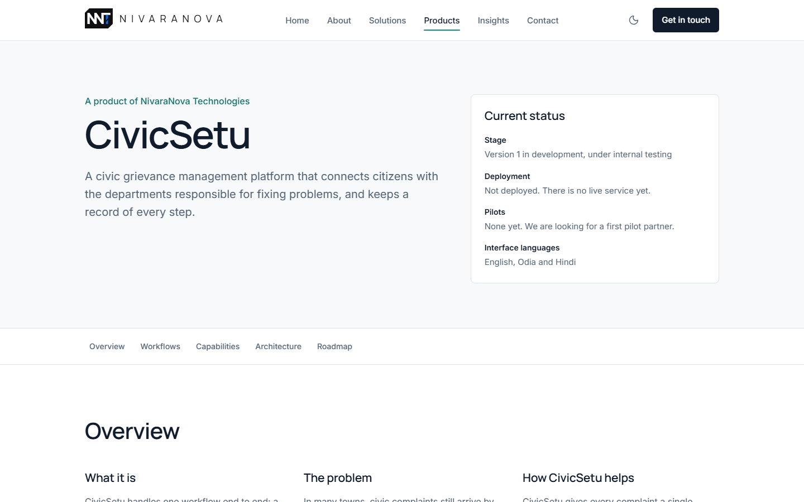
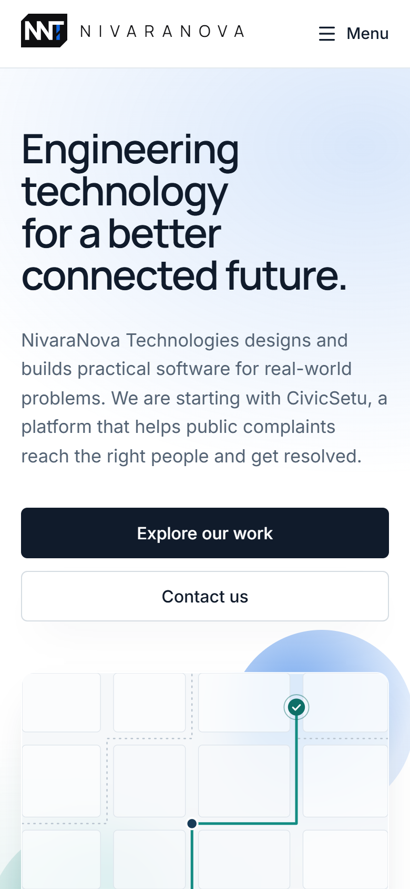
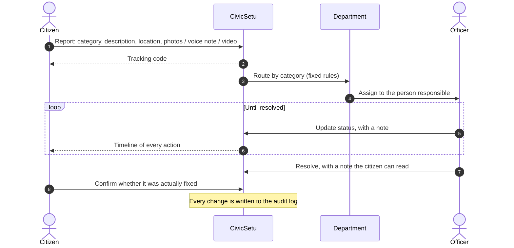
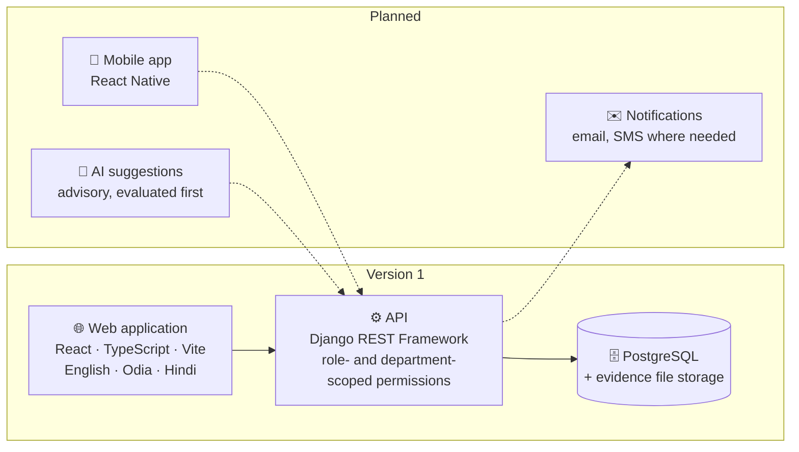
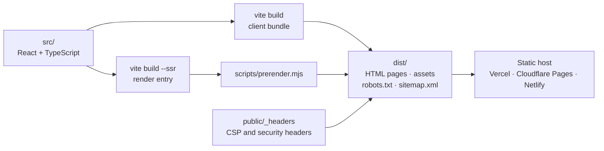

<a id="readme-top"></a>

<div align="center">



<br>

**Engineering technology for a better connected future.**

An early-stage technology company from Gunupur, Odisha, building practical software for problems in public services, starting with **CivicSetu**.

<br>


[**About**](#-about-nivaranova) · [**CivicSetu**](#-civicsetu) · [**Solutions**](#-what-we-do) · [**Work with us**](#-work-with-us) · [**Run the website**](#-run-the-website) · [**Contact**](#-contact)

</div>

<br>

<details>
<summary><b>📑 Contents</b> (click to expand)</summary>

<br>

1. [About NivaraNova](#-about-nivaranova)
2. [The website](#-the-website)
3. [CivicSetu](#-civicsetu)
   - [How a complaint moves](#how-a-complaint-moves)
   - [Who uses it](#who-uses-it)
   - [What is built, tested and planned](#what-is-built-tested-and-planned)
   - [Architecture](#architecture)
   - [Roadmap](#roadmap)
4. [What we do](#-what-we-do)
5. [How we work](#-how-we-work)
6. [Work with us](#-work-with-us)
7. [Run the website](#-run-the-website)
8. [Developer guide](#-developer-guide)
9. [Contact](#-contact)

</details>

---

## 🏢 About NivaraNova

> **nivaran** (*noun*): resolution, or redressal.

NivaraNova is an early-stage technology company from **Gunupur, Odisha, India**. The name describes the work we choose: problems where better software means issues actually get **resolved**, not just recorded.

We start small and specific, build carefully, and say plainly what is finished and what is not.

<table>
<tr>
<td width="50%" valign="top">

### 🎯 Vision

To build meaningful technology that makes digital experiences and essential services more accessible, intelligent and effective.

</td>
<td width="50%" valign="top">

### 🧭 Mission

To engineer practical, scalable software for real-world problems, starting by giving citizens a reliable way to report civic issues and giving authorities the tools to resolve them on time.

</td>
</tr>
</table>

**Where we are building capability**

| Focus area | In one line |
|---|---|
| Software engineering | Well-structured software that is easy to run and to change. |
| Digital product development | Turning a real workflow into a simple, usable product. |
| AI-enabled applications | Machine learning where it measurably helps, with a person accountable. |
| Intelligent platforms | Systems that route, track and report on work. |
| Enterprise technology solutions | Software for organisations with several departments and roles. |

<p align="right"><a href="#readme-top">↑ Back to top</a></p>

---

## 💻 The website

This repository is the company website: eight pages, prerendered to plain HTML, with a light and a dark theme. The screenshots below follow your GitHub theme.

<picture>
  <source media="(prefers-color-scheme: dark)" srcset="docs/assets/home-dark.png">
  
</picture>

<table>
<tr>
<td width="68%" valign="top">

<picture>
  <source media="(prefers-color-scheme: dark)" srcset="docs/assets/civicsetu-dark.png">
  
</picture>

<p align="center"><sub>The CivicSetu page states its status openly</sub></p>

</td>
<td width="32%" valign="top">

<picture>
  <source media="(prefers-color-scheme: dark)" srcset="docs/assets/mobile-dark.png">
  
</picture>

<p align="center"><sub>Built for small screens first</sub></p>

</td>
</tr>
</table>

| Page | What it covers |
|---|---|
| `/` | Who we are, CivicSetu at a glance, how a complaint moves |
| `/about` | The name, vision and mission, how we approach AI |
| `/solutions` | Six areas of work, each with problem, approach and value |
| `/products` and `/products/civicsetu` | CivicSetu in full: workflows, capabilities, architecture, roadmap |
| `/insights` | Articles (published only when a real one is ready) |
| `/contact` | Enquiry form, email and phone |
| `/privacy` | Plain-language privacy notice |

<p align="right"><a href="#readme-top">↑ Back to top</a></p>

---

## 📣 CivicSetu

**Every civic complaint on one record, from the moment it is reported to the moment it is fixed.**

CivicSetu is a civic grievance management platform that connects citizens with the departments responsible for fixing problems, and keeps a record of every step.

> [!IMPORTANT]
> **Current status.** Version 1 is in development and under internal testing. It is **not deployed**: there is no live service yet, and there are no pilots yet. We are looking for a first pilot partner. Interface languages: **English, Odia and Hindi**.

<table>
<tr>
<td width="50%" valign="top">

**❌ Before**

Complaints arrive by phone calls, counter visits, paper registers and messaging groups. They are hard to route and hard to follow up, and the person who reported one rarely hears what happened to it.

</td>
<td width="50%" valign="top">

**✅ With CivicSetu**

- One record for every complaint
- Sent to the department responsible
- Followed with a tracking code
- Closed with a resolution note
- Confirmed by the citizen
- Every change logged

</td>
</tr>
</table>

Complaint categories in version 1: **Roads · Water supply · Electricity · Drainage · Sanitation**

### How a complaint moves



### Who uses it

<details>
<summary><b>👤 Citizens</b>: report a problem with evidence, then follow it until it is fixed</summary>

<br>

- Category, description and exact location
- Photos, a voice note or a short video
- A tracking code and a timeline of every action
- A say in whether the problem was really fixed

</details>

<details>
<summary><b>🧑‍💼 Officers</b>: a clear queue of the complaints that belong to their department</summary>

<br>

- Only their own department's complaints
- Assignment to the person responsible
- A status update and note at every step
- A resolution note the citizen can read

</details>

<details>
<summary><b>🛠️ Administrators</b>: the whole picture, and the rules that keep complaints moving</summary>

<br>

- Departments, users and roles
- Category-to-department routing rules
- An audit log of every change

</details>

### What is built, tested and planned

Every capability has a status, and each status is backed by a recorded source of evidence in [`src/content/civicsetu.ts`](src/content/civicsetu.ts). A unit test fails if anything is upgraded without evidence.

<details>
<summary> &nbsp;Built and covered by the V1 automated test suite, as reported by the development team</summary>

<br>

| Capability | What it does |
|---|---|
| Complaint submission | Category, description and location recorded for every complaint. |
| Photo, audio and video evidence | Photos, voice notes and short videos attached to a complaint. |

Not yet used in a live deployment. The test results are as reported by the development team; they were not re-run for this website.

</details>

<details>
<summary> &nbsp;Built in the V1 codebase and going through internal testing</summary>

<br>

| Capability | What it does |
|---|---|
| Role-based access | Citizens see their own complaints, officers their department's queue, administrators manage the system. |
| Citizen registration and sign-in | Personal accounts with token-based authentication. |
| Tracking code and complaint history | A code to follow each complaint, with a timeline of status changes and notes. |
| Routing to departments | A fixed category-to-department map sends each complaint to the right team. |
| Rule-based priority | Priority set by clear, predictable rules rather than a model. |
| Officer workflow | Department queue, assignment, status updates and resolution notes. |
| Citizen feedback | Citizens say whether a resolved complaint was actually fixed. |
| Administration and audit log | Manage users, roles, departments and routing; every change is recorded. |
| English, Odia and Hindi | The interface is available in three languages. |

</details>

<details>
<summary> &nbsp;On the roadmap, not built yet</summary>

<br>

| Capability | What it will do |
|---|---|
| Email and SMS notifications | Alerts to citizens and officers when a complaint changes status. |
| AI-assisted categorisation and priority | Suggestions only, checked by a person, introduced after evaluation on real complaint data. |
| Mobile app | A React Native app for citizens. |
| Reports and analytics | Resolution times and backlogs by department, ward and category. |
| Integrations | Connections to systems a municipality already uses. |

</details>

### Architecture

Solid lines are version 1. Dashed lines are planned.



### Roadmap

<table>
<tr>
<th width="33%">🔨 Now</th>
<th width="33%">🤝 Next</th>
<th width="33%">🔭 Later</th>
</tr>
<tr>
<td valign="top">

- [ ] Finish version 1 and run the full test suite against PostgreSQL
- [ ] Security review: access rules, upload validation, private file delivery
- [ ] A low-cost pilot deployment with HTTPS and tested backups

</td>
<td valign="top">

- [ ] A 6–8 week pilot with one campus or municipal body
- [ ] Measure time to assign, time to resolve, and resolutions confirmed by citizens
- [ ] Email notifications, and SMS where the pilot partner needs it

</td>
<td valign="top">

- [ ] A React Native app for citizens
- [ ] AI suggestions for category and priority, once pilot data shows they help
- [ ] Integrations with systems municipalities already use

</td>
</tr>
</table>

<p align="right"><a href="#readme-top">↑ Back to top</a></p>

---

## 💼 What we do

Six areas of work, written as our approach rather than packaged services. No certifications or guaranteed outcomes are offered. Click any area for the details.

<details>
<summary><b>Custom software development</b>: software built around how your organisation actually works</summary>

<br>

| | |
|---|---|
| **The problem** | Off-the-shelf tools rarely match a specific process, so teams work around them with spreadsheets, messaging groups and paper registers. |
| **Our approach** | Map the current workflow with the people who do it, agree a narrow first version, and build it in small, reviewed increments with automated tests. You receive the code and documentation. |
| **What you get** | A system that fits the process, can be maintained after handover, and does not tie you to a single vendor. |
| **Technology** | TypeScript · React · Python · Django · PostgreSQL |

</details>

<details>
<summary><b>Web and mobile application development</b>: fast, accessible applications for browsers and phones</summary>

<br>

| | |
|---|---|
| **The problem** | Many public-facing services are hard to use on low-cost phones and slow connections, which shuts out the people who need them most. |
| **Our approach** | Design for small screens first, keep pages light, support local languages, test with keyboard and screen readers, and build a native app with React Native only when it is justified. |
| **What you get** | Services that more people can use, on the devices they already own. |
| **Technology** | React · TypeScript · Vite · React Native · i18next |

</details>

<details>
<summary><b>AI-enabled digital solutions</b>: machine learning used where it measurably helps</summary>

<br>

| | |
|---|---|
| **The problem** | AI is often added to software before there is data to evaluate it, which makes its results hard to trust or explain. |
| **Our approach** | Start with a working rule-based system, collect labelled data from real use, then test whether a model beats that baseline. Models suggest; people decide. |
| **What you get** | Automation you can measure and explain, introduced only when it improves on a simpler approach. |
| **Technology** | Python · scikit-learn · held-out evaluation · human review workflows |

</details>

<details>
<summary><b>Workflow automation</b>: fewer manual hand-offs between people and departments</summary>

<br>

| | |
|---|---|
| **The problem** | Requests get lost between inboxes, phone calls and registers. Nobody can see who holds a task or how long it has been waiting. |
| **Our approach** | Model the workflow explicitly, with its states, owners and routing rules, and record every change so that delays are visible. |
| **What you get** | Clear ownership of each task, and a record of what happened, when and by whom. |
| **Technology** | Django REST Framework · PostgreSQL · role-based access · audit logging |

</details>

<details>
<summary><b>Digital transformation</b>: moving paper and phone processes online, one process at a time</summary>

<br>

| | |
|---|---|
| **The problem** | Large digitisation projects often try to replace everything at once and stall before anyone benefits. |
| **Our approach** | Pick one high-volume process, digitise it end to end, compare the result with the old process, then move to the next one. |
| **What you get** | Visible improvement early, with each further step justified by results. |
| **Technology** | Process mapping · data migration · PostgreSQL · staff guides |

</details>

<details>
<summary><b>Technology consulting</b>: independent advice on architecture, hosting and running costs</summary>

<br>

| | |
|---|---|
| **The problem** | Small organisations are often sold infrastructure sized for far more users than they have, and then pay for it every month. |
| **Our approach** | Review what you have, estimate the real load, and recommend the simplest architecture that meets it, with the costs written down. |
| **What you get** | Decisions you can explain to your finance team, on infrastructure that fits your budget. |
| **Technology** | Architecture review · cost estimation · security baseline · PostgreSQL |

</details>

<p align="right"><a href="#readme-top">↑ Back to top</a></p>

---

## 🧪 How we work

> [!NOTE]
> **Rules first, models later, people accountable.** A feature starts as a clear, rule-based system that people can understand and check. Once real use produces data, we test whether a model does better, and we keep a person accountable for each decision.
>
> That is why CivicSetu's first version has **no machine learning in the complaint path**. Citizens choose the category, and fixed rules route and prioritise each complaint. AI suggestions are planned for later, once they can be evaluated against pilot data.

- **Start small and specific.** We are beginning with grievance handling for municipalities and campuses. Over time, we aim to offer configurable, integration-ready workflow software for public-service organisations in India.
- **Say plainly what is finished.** Every CivicSetu capability on the website carries a status (tested, implemented or planned), and automated tests stop the site from drifting into claims the evidence does not support.
- **Grow through careful pilots and honest results** rather than broad claims.

<p align="right"><a href="#readme-top">↑ Back to top</a></p>

---

## 🤝 Work with us

<div align="center">

**Have a problem worth solving?**

We are looking for a **first pilot partner** for CivicSetu: one campus or municipal body, for a pilot of six to eight weeks.

[](mailto:nivaranovapvtltd@gmail.com?subject=CivicSetu%20pilot)
&nbsp;
[](mailto:nivaranovapvtltd@gmail.com?subject=Software%20project)

</div>

<p align="right"><a href="#readme-top">↑ Back to top</a></p>

---

## 🚀 Run the website

You need **Node.js 20.19 or newer** (developed on Node 22) and **npm 10 or newer**.

```bash
git clone https://github.com/sujitsahu461/NIVARANOVA-TECHNOLOGIES-PVT-LTD.git
cd NIVARANOVA-TECHNOLOGIES-PVT-LTD
npm install
cp .env.example .env    # then fill in VITE_WEB3FORMS_ACCESS_KEY
npm run dev             # http://localhost:5173
```

> [!TIP]
> Without a key in `.env` the site still runs. The contact form then tells visitors plainly that it cannot send yet, instead of pretending to.

It is a **static site**: React and TypeScript, built with Vite, with every page prerendered to plain HTML at build time. There is no server to run and no database. Any static host can serve the `dist/` folder.

<p align="right"><a href="#readme-top">↑ Back to top</a></p>

---

## 📘 Developer guide

Everything below is collapsed. Open the section you need. For what was built, the test results and the open items before launch, see [**docs/HANDOVER.md**](docs/HANDOVER.md).

<details>
<summary><b>⌨️ Commands</b></summary>

<br>

| Command | What it does |
|---|---|
| `npm install` | Install dependencies. Use `npm ci` in CI. |
| `npm run dev` | Development server at http://localhost:5173 with hot reload. |
| `npm run typecheck` | TypeScript check in strict mode. |
| `npm run lint` | oxlint, including accessibility rules. Fails on any warning. |
| `npm test` | Unit tests (Vitest): form validation, submission, content guards, contact form behaviour. |
| `npm run build` | Typecheck, build, then prerender every page into `dist/`. |
| `npm run preview` | Serve `dist/` at http://localhost:4173 with the production security headers. |
| `npm run test:e2e` | Browser tests (Playwright) against the production build, including the security tests. Run `npm run build` first. |
| `npm run test:security` | Dependency audit, build, then only the security tests (`e2e/security.spec.ts`). |
| `npm run audit` | `npm audit`: fails on any high or critical vulnerability in a dependency. |
| `npm run check` | Typecheck, lint, unit tests, audit, build and all browser tests, in order. **Run this before every deploy.** |
| `npm run generate:assets` | Rewrite `favicon.svg` and re-render `og-image.png`, `logo-512.png` and the PNG icons from `src/config/brand.ts` after changing the logo. |

The first time you run the browser tests, install Playwright's browser:

```bash
npx playwright install chromium
```

Or point the tests at an installed Chrome: `CHROME_PATH=/path/to/chrome npm run test:e2e`.

</details>

<details>
<summary><b>🗂️ Where things live</b></summary>

<br>

Unit tests sit next to the code they test, as `*.test.ts(x)`. Browser tests are in `e2e/`.

```
.env.example               Template for build settings. Copy to .env (ignored by git).
docs/
  HANDOVER.md              What was built, test results, open items before launch
  assets/                  Screenshots used in this README
src/
  config/company.ts        Business identity: legal name, contact details, CIN, GSTIN. Edit here first.
  content/                 All page copy that changes over time
    routes.ts              Page titles, descriptions and the main navigation
    civicsetu.ts           CivicSetu status, workflows, capabilities (with evidence), architecture, roadmap
    solutions.ts           The six solution areas
    focus-areas.ts         Home page focus areas
    insights.ts            Articles (empty until the first real one is written)
  pages/                   One component per page
  components/
    layout/                Page frame, footer, error boundary
    navigation/            Header and mobile menu
    sections/              Larger reusable blocks (page header, workflow steps, contact form, hero map…)
    ui/                    Small building blocks (button, logo, status badge, placeholder)
  lib/                     Contact form rules and submission, light and dark themes, helpers
  styles/index.css         Design tokens (colours for both themes, fonts, type scale) and base styles
  assets/fonts/            Self-hosted Inter and Manrope (Latin subset, SIL OFL)
  entry-server.tsx         Build-time entry used only for prerendering
scripts/
  prerender.mjs            Writes the static HTML pages, robots.txt and sitemap.xml
  generate-brand-assets.mjs
public/
  _headers                 Security and caching headers (Cloudflare Pages / Netlify format; vercel.json repeats them)
  favicon.svg, *.png       Icons and the social sharing image
  theme.js                 Applies a saved dark theme before the page paints
e2e/                       Playwright browser tests
  fixtures.ts              Shared page list, error-catching test fixture, fake Web3Forms
  security.spec.ts         Security tests: secrets, .gitignore, build output, headers, CSP, XSS, clickjacking
```

**How a build becomes a website**



</details>

<details>
<summary><b>✏️ Common edits</b></summary>

<br>

- **Add verified company details** (email, phone, CIN, GSTIN): fill in `src/config/company.ts`. The CIN and GSTIN appear in the footer only once set; nothing is shown for them until then. One unit test checks these fields are still empty, so update it in the same change; that keeps the edit deliberate.
- **Change CivicSetu's status or a capability**: edit `src/content/civicsetu.ts`. Every capability carries an `evidence` note. A unit test fails if something is marked `tested` without test evidence, or if an AI feature is marked anything other than `planned`.
- **Publish an article**: add an entry to `src/content/insights.ts`, dated the day it goes live. It gets its own page at `/insights/<slug>` and is added to the sitemap automatically.
- **Change colours or fonts**: `src/styles/index.css`. Tailwind's default palette is switched off, so only the tokens defined there can be used. Each colour has a light value in `@theme` and a dark value under `:root[data-theme='dark']`; set both, and check text keeps 4.5:1 contrast in each. Colours are named for their role (`bg-surface` is the page, `text-ink` the text), so one class works in both themes. Only `night`, `white` and `teal-soft` stay fixed, for the dark closing band.
- **Refresh the README screenshots** after a design change: replace the PNGs in `docs/assets/` (desktop at 1440 × 900, phone at 390 × 844), one light and one dark of each.

</details>

<details>
<summary><b>⚙️ Configuration (.env)</b></summary>

<br>

Copy `.env.example` to `.env` for local work, and set the same variables in your host's build settings for deploys. `.env` and every `.env.*` file except the example are ignored by git, and a security test fails if the key in `.env` shows up in any committed file.

> [!WARNING]
> Every `VITE_` variable is compiled into the public JavaScript, so anyone can read it in the browser. Never put a password, private API key or token in a `VITE_` variable.

| Variable | Purpose |
|---|---|
| `VITE_SITE_URL` | Final address, e.g. `https://www.example.in`. Turns on canonical URLs, `og:url`, the social image tag and `sitemap.xml`. |
| `VITE_WEB3FORMS_ACCESS_KEY` | Web3Forms key for the company inbox. Without it (or `VITE_CONTACT_ENDPOINT`) the form says it cannot send, and the build prints a warning. |
| `VITE_CONTACT_ENDPOINT` | Optional. Your own HTTPS URL that accepts the contact form as JSON; overrides Web3Forms. See *Contact form*. |
| `VITE_SHOW_PLACEHOLDERS` | `false` hides the "to be added" labels for missing details. |

npm packages are not configured here: they are listed in `package.json` and pinned in `package-lock.json`.

</details>

<details>
<summary><b>📨 Contact form</b></summary>

<br>

**Current setup: Web3Forms.** Enquiries are emailed to nivaranovapvtltd@gmail.com through [Web3Forms](https://web3forms.com), a free form-to-email service. The access key is read from `VITE_WEB3FORMS_ACCESS_KEY`, so it stays out of the repository. It still ends up in the public JavaScript, which is how Web3Forms works: the key can only send mail to the inbox it was created for. To get a new key, enter the inbox address at web3forms.com; the key arrives by email. Replying to an enquiry email replies straight to the visitor.

Web3Forms runs its own spam check. The site adds a hidden honeypot field and a minimum fill time, and validates every field before sending. There is no server-side validation or rate limiting of our own; if spam becomes a problem, move to your own endpoint.

**Your own endpoint.** Setting `VITE_CONTACT_ENDPOINT` overrides Web3Forms. The form then POSTs JSON to that address:

```json
{
  "fullName": "…", "workEmail": "…", "organisation": "…",
  "subject": "…", "enquiryType": "general | civicsetu | project | partnership | other",
  "message": "…",
  "meta": { "elapsedMs": 8421, "source": "website-contact" }
}
```

It treats any 2xx response as sent. The receiving end must:

1. Validate every field again. `src/lib/enquiry.ts` has no browser dependencies, so its `validateEnquiry` can be reused in a Node or serverless function.
2. Rate-limit by IP, and discard requests where `meta.elapsedMs` is under about 3 seconds.
3. Allow CORS only from the site's own origin.
4. Return a generic error message, never internal details.

Then put the endpoint's origin in `connect-src` in `public/_headers` (in place of `https://api.web3forms.com`), or the browser will block the request.

Options, cheapest first: a small serverless function on the same host (Cloudflare Pages Functions or Netlify Functions, both free at this volume) that emails the enquiry; a form-delivery service; or an endpoint on the CivicSetu Django backend once it is deployed.

</details>

<details>
<summary><b>🔒 Security and testing</b></summary>

<br>

| Layer | What protects it | Checked by |
|---|---|---|
| Secrets | No keys in the code; `.env`, key and credential files ignored by git | `e2e/security.spec.ts` (pattern scan, real-key scan, asks git itself) |
| Dependencies | `npm audit` at high severity | `npm run audit` |
| Browser | Strict Content Security Policy (own origin only, no inline scripts), `X-Frame-Options: DENY`, `nosniff`, strict referrer policy, restrictive `Permissions-Policy`, COOP, HSTS | Security tests on every page, the 404 page and static files |
| Injection | No `dangerouslySetInnerHTML`, `eval` or `innerHTML`; all input rendered as text | Lint rule, source scan, hostile-input browser tests |
| Clickjacking | `frame-ancestors 'none'` | A browser test that tries to frame the site |
| Build output | No source maps, env files, source code or local paths in `dist/` | Build-output tests |
| Privacy | No cookies, analytics or third-party requests | Browser tests |
| Accessibility | WCAG 2.2 AA, keyboard paths, reduced motion | axe-core on every page, both themes |
| Honesty | No invented contact details, registration numbers or unsupported claims | Unit content guards and a rendered-text scan |

</details>

<details>
<summary><b>☁️ Deployment</b></summary>

<br>

The output is static, so hosting can cost nothing. The domain is the only recurring cost.

**Before every deploy**

- [ ] `npm run check` passes (it includes the dependency audit and the security tests)
- [ ] The host's build settings have `VITE_WEB3FORMS_ACCESS_KEY` (and `VITE_SITE_URL` once the domain is live). `.env` is not uploaded with the repository.
- [ ] `git status` shows no `.env`, key or credential files about to be committed

**Vercel (current host)**: everything is in [`vercel.json`](vercel.json): build command, output folder, clean URLs and the security headers. Vercel does not read `_headers`, so `vercel.json` repeats them, and a security test fails if the two files ever differ. `.vercelignore` stops the CLI from uploading `.env` or local build output. In the Vercel project, add `VITE_WEB3FORMS_ACCESS_KEY` (and `VITE_SITE_URL`) under **Settings → Environment Variables**, then redeploy. With the GitHub repository connected, every push to `main` deploys.

```bash
npx vercel login          # once, in your own browser
npx vercel --prod         # build on Vercel and publish
```

**Cloudflare Pages**: connect the repository, then set:

- Build command: `npm run build`
- Output directory: `dist`
- Environment variables: `VITE_WEB3FORMS_ACCESS_KEY`, `VITE_SITE_URL`, plus `NODE_VERSION=22`

Pages reads `dist/_headers` for security headers, serves `/about` from `about.html`, and returns `404.html` with a real 404 status for unknown addresses.

**Netlify** works the same way with the same settings.

**Any other static host or nginx**: serve `dist/`, map clean URLs to `.html` files, and copy the headers from `public/_headers` into the server config:

```nginx
location / {
  try_files $uri $uri.html $uri/ =404;
}
error_page 404 /404.html;
location /assets/ {
  add_header Cache-Control "public, max-age=31536000, immutable";
}
```

After the first deploy, check the headers at https://securityheaders.com and the social card with any Open Graph preview tool.

</details>

<details>
<summary><b>📜 Licences</b></summary>

<br>

Inter and Manrope are under the SIL Open Font License 1.1 (`src/assets/fonts/*-OFL.txt`). Icons are from Lucide (ISC). The NivaraNova mark and the route illustration are original to this project.

</details>

<p align="right"><a href="#readme-top">↑ Back to top</a></p>

---

## 📬 Contact

| | |
|---|---|
| ✉️ **Email** | [nivaranovapvtltd@gmail.com](mailto:nivaranovapvtltd@gmail.com) |
| 📞 **Phone** | +91 76568 52710 |
| 📞 **Alternate** | +91 82602 35030 |
| 📍 **Based in** | Gunupur, Odisha, India |

<br>

<div align="center">


<sub>© NivaraNova Technologies Pvt. Ltd. · Built in Gunupur, Odisha</sub>

<sub><a href="#readme-top">↑ Back to top</a></sub>

</div>
